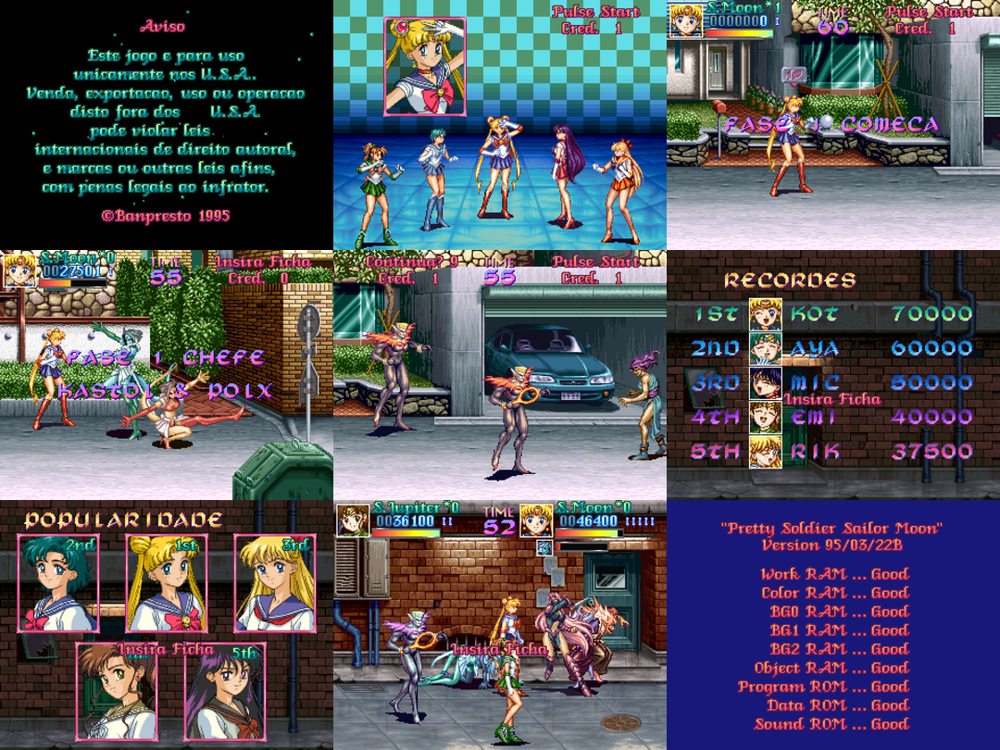

# Pretty Soldier Sailor Moon (arcade, 1995) — tradução PT-BR

Tradução para português brasileiro de **Pretty Soldier Sailor Moon** (Gazelle/Banpresto, 1995), conjunto `sailormnu` do MAME/FBNeo.
Só texto, em ASCII **sem acentos** (o jogo não tem letras acentuadas). Muda um único arquivo do conjunto: `bpsm945a.u45`.

## Baixar o patch
Na página de [Releases](https://github.com/anondaniel/SailorMoon-Arcade-PTBR/releases): `SailorMoon_Arcade_PTBR_v1.0.zip` (patch BPS e IPS + LEIAME com hashes e instruções).
Este repositório **não contém ROM**: use o seu próprio conjunto `sailormnu`.

| | CRC32 | tamanho |
|---|---|---|
| `bpsm945a.u45` original | `898C9515` | 524288 |
| `bpsm945a.u45` traduzido | `D429F659` | 524288 |

## Código
- `03_Traducao/traducao_ptbr.py`: dicionário dos 70 textos e geração do u45 traduzido (lê o conjunto original, não incluído aqui).
- `tools/`: `patch_u45.py` (aplica textos e corrige o checksum), `gerar_bps.py` (gera e confere BPS/IPS), scripts Lua para o MAME.
- `06_Documentacao/ANALISE_INICIAL.md`: como o texto foi achado.

Créditos: tradução e hacking — Daniel Figueira. Jogo original — Banpresto/Gazelle, baseado na obra de Naoko Takeuchi.
